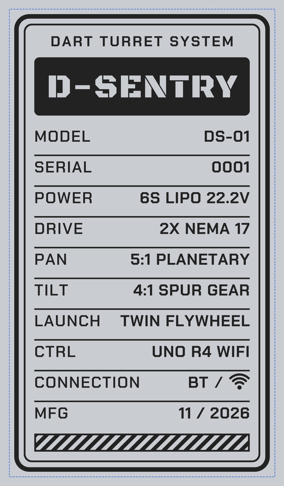

# D-Sentry

A pan/tilt foam-dart turret, aimed and fired with an Xbox controller. The brain is an Arduino
UNO R4 WiFi: its main chip (RA4M1) runs all turret logic, and its on-board radio chip
(ESP32-S3) runs custom firmware that talks to the controller over Bluetooth, or to a PC over
WiFi, and streams a control packet to the RA4M1 over an internal serial link.



Two steppers drive pan (5:1 reduction) and tilt (5:1, on a 220 mm arm). A servo drives the
dart pusher. Two DC motors spin the flywheels. A WS2812 LED ring and a 16×2 LCD show turret
state. Full behavior spec: [`D-SENTRY_SPEC.md`](D-SENTRY_SPEC.md).

## How the controller reaches the turret

| Mode | Where the pad pairs | Path |
|---|---|---|
| **Bluetooth** | directly with the turret | Xbox pad → ESP32-S3 (BLE) → serial link → RA4M1 |
| **WiFi** | with a PC | Xbox pad → PC relay → UDP → ESP32-S3 → serial link → RA4M1 |

The two radio modes never run at once; a physical toggle switches between them. Full system
diagram and contract: [`Software/System Block Diagram/`](Software/System%20Block%20Diagram/).

## Repository layout

```
Mechanical/
  CAD/            vendor reference parts, printable meshes, nameplate art
  Gcode/          testing/ (fit & calibration prints), final/ (the turret's own parts)
  Fitment/        measured fit values (fasteners, bearings, LCD, gears)
Hardware/
  BOM/            parts list
  Wiring Diagram/ current wiring, plus the full revision history
Software/
  System Block Diagram/              the architecture, as text and as a diagram
  Custom Firmware/                   ESP32-S3: forked USB-bridge + Xbox BLE host + D-Sentry radio modes
  Local Web Server for WiFi Connect Mode/   PC relay + live dashboard, used in WiFi mode
  Turret Code for the Arduino/       the RA4M1 sketch that runs the turret
```

Every one of those folders has its own README with the detail — this file is the map.

## Building it yourself

1. **Mechanical** — print the parts in `Mechanical/Gcode/final/` (PETG, nylon for the pan
   pinion). `Mechanical/CAD/README.md` explains what's here as ready-to-print meshes versus
   what's still only in Fusion 360 and needs exporting.
2. **Hardware** — wire it per `Hardware/Wiring Diagram/`; parts list in `Hardware/BOM/`.
3. **Software**, in order:
   - Flash the ESP32-S3 radio firmware — `Software/Custom Firmware/README.md`.
   - Upload the RA4M1 sketch — `Software/Turret Code for the Arduino/README.md`.
   - For WiFi mode, run the PC relay — `Software/Local Web Server for WiFi Connect Mode/README.md`.

## Status

Built for a university mechanical engineering project (hence the `A4` in the original working
directory). The turret has been bench-tuned on real hardware: firing runs a three-position
servo sequence (REST/PRE-FIRE/FIRE — `DECISIONS.md` D27), and pan and tilt directions, speeds
and calibration timing were all tuned on the bench (D28-D29). This repo tracks `turret-live`,
the branch actually running on the turret. `Software/Turret Code for the Arduino/docs/bench-checklist.md`
is the first-power-up-to-acceptance-criteria checklist; `DECISIONS.md` is the full log of what
was decided, why, and what was tried instead.

## History

The ESP32-S3 side started as an overnight, unattended build (2026-10-11/12): forking Arduino's
own `uno-r4-wifi-usb-bridge` firmware to add an Xbox controller as a BLE host, reviewed twice
over (`DECISIONS.md` D14) before ever touching real hardware, then bench-tested the next day.
D-Sentry itself — the turret's own state machine, motion control, PC relay and dashboard — was
built from a full specification (`D-SENTRY_SPEC.md`) in a single day (2026-11-03), simulated
against a fake hardware layer before ever running on the real board, then bench-tuned on the
real turret the same afternoon. Bench tuning continued past that first day on `turret-live`:
reworking the firing sequence, flipping and re-tuning pan and tilt, and chasing down a
dead pad pairing, a frozen board, and a frozen LCD — all fixed, all in `DECISIONS.md` D26-D31.
Every non-obvious decision along the way, and every alternative considered, is recorded in
`DECISIONS.md`.

Partway through, modeling gears by hand got tedious enough that we also built **GearForge**,
a separate Fusion 360 add-in for generating parametric ISO gear profiles — every gear in
this turret (tilt, pan planetary, shooter rack-and-pinion) was generated with it; see
`Mechanical/CAD/README.md`.

## License

The mechanical design, hardware docs, and D-Sentry's own software are **MIT**. The ESP32-S3
firmware image is **AGPL-3.0** as a whole, because it links SudoMaker's `chAT` AT-command
server — see [`NOTICE.md`](NOTICE.md) before you flash or share a build, and
[`THIRD_PARTY.md`](THIRD_PARTY.md) for every component's exact license.

## Credits

Built on [`arduino/uno-r4-wifi-usb-bridge`](https://github.com/arduino/uno-r4-wifi-usb-bridge),
SudoMaker's `chAT`, [h2zero/NimBLE-Arduino](https://github.com/h2zero/NimBLE-Arduino), and
asukiaaa's Xbox controller libraries. Full list with versions and licenses in
[`THIRD_PARTY.md`](THIRD_PARTY.md).
