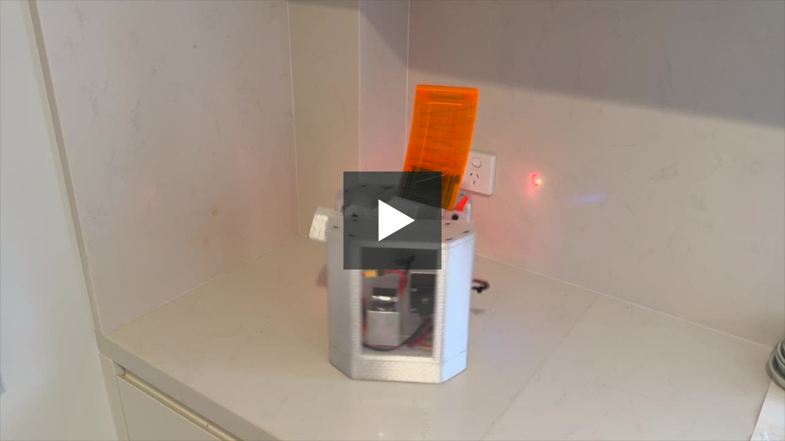

# D-Sentry

[](https://youtu.be/MnPMdeEDEXg)

A pan/tilt foam-dart turret you aim and fire with an Xbox controller. An Arduino UNO R4 WiFi
runs it: the main chip (RA4M1) runs the turret, and the radio chip (ESP32-S3) runs custom
firmware that talks to the controller over Bluetooth, or to a PC over WiFi, and passes each
control packet to the RA4M1 over a serial link.


Two steppers drive pan (5:1 planetary) and tilt (5:1, 220 mm arm). A servo pushes each dart
into two DC-motor flywheels. A WS2812 LED module and a 16×2 LCD show the turret's state. Full
behaviour: [`D-SENTRY_SPEC.md`](D-SENTRY_SPEC.md).

## How the controller reaches the turret

| Mode | The pad pairs with | Path |
|---|---|---|
| **Bluetooth** | the turret | pad → ESP32-S3 (BLE) → serial link → RA4M1 |
| **WiFi** | a PC | pad → PC relay → UDP → ESP32-S3 → serial link → RA4M1 |

A toggle switch picks the mode; the two never run at once. System diagram:
[`Software/`](Software/).

## Layout

```
Mechanical/
  CAD/        Fusion 360 source, printable meshes, vendor parts, nameplate
  Gcode/      final/ (turret parts) and testing/ (fit prints)
  fitment.md  measured fits for fasteners, bearings, LCD and shafts
Hardware/
  BOM.md            parts list
  Wiring Diagram/   current wiring and every past revision
Software/
  architecture.md                         the build contract, with diagrams beside it
  Custom Firmware/                        ESP32-S3: Xbox BLE host and radio modes
  Local Web Server for WiFi Connect Mode/ PC relay and live dashboard
  Turret Code for the Arduino/            the RA4M1 sketch
```

Each folder's README holds the detail.

## Build it

1. Print `Mechanical/Gcode/final/` in PETG, with the pan pinion in nylon.
2. Wire it per `Hardware/Wiring Diagram/`, from the parts in `Hardware/BOM.md`.
3. Flash the ESP32-S3 (`Software/Custom Firmware/`), then upload the RA4M1 sketch
   (`Software/Turret Code for the Arduino/`). For WiFi mode, run the PC relay
   (`Software/Local Web Server for WiFi Connect Mode/`).

Clone with `git clone --recursive`; the firmware build needs its submodules.

## Status and history

A university mechanical engineering project. The ESP32-S3 firmware began as an unattended
overnight build on 2026-10-11, forking Arduino's `uno-r4-wifi-usb-bridge` to add an Xbox
controller as a BLE host. The turret code was built from `D-SENTRY_SPEC.md` in one day
(2026-11-03), tested against a simulated board, then tuned on the real turret. This repo
tracks `turret-live`, the branch on the turret. `DECISIONS.md` records every non-obvious
choice and what else was tried; `Software/Turret Code for the Arduino/docs/bench-checklist.md`
takes you from first power-up to the acceptance tests.

Every gear was generated with GearForge, a Fusion 360 add-in we built alongside this project
(see `Mechanical/CAD/README.md`).

## Licence

Our own work is MIT. The compiled ESP32-S3 firmware is AGPL-3.0 as a whole, because it links
SudoMaker's `chAT`. Read [`THIRD_PARTY.md`](THIRD_PARTY.md) before you share a build; it also
lists every third-party part with its version and licence.

Built on [`arduino/uno-r4-wifi-usb-bridge`](https://github.com/arduino/uno-r4-wifi-usb-bridge),
SudoMaker's `chAT`, [h2zero/NimBLE-Arduino](https://github.com/h2zero/NimBLE-Arduino) and
asukiaaa's Xbox controller libraries.
